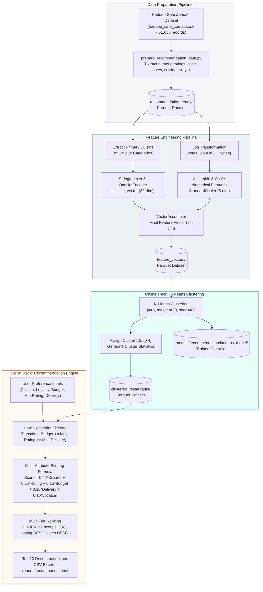

# Stage 8 – Restaurant Recommendation System using Apache Spark MLlib

**Project:** FoodieAnalytics: Food Delivery Analytics and Restaurant Recommendation System using Big Data  
**Stage:** 8 – Content-Based Restaurant Recommendation and Machine Learning with PySpark MLlib  
**Dataset:** Zomato Bangalore Restaurant Dataset (51,656 records, 17 features)  
**Execution Environment:** Ubuntu 24.04.5 LTS on WSL2, Python 3.12.3, Apache Spark (PySpark) 4.0.1, Apache Hadoop 3.4.3, OpenJDK 21  

---

## 1. Stage 8 Title and Objective

### Title
**Stage 8: Restaurant Recommendation System and Unsupervised Clustering using Apache Spark MLlib**

### Objective
The primary objective of Stage 8 is to construct an end-to-end, scalable, content-based restaurant recommendation engine and unsupervised grouping pipeline for Bangalore's food delivery ecosystem. Leveraging **Apache Spark MLlib**, the stage accomplishes:
1. **Feature Engineering:** Parsing, standardizing, and extracting primary cuisine tags, log-transforming skewed engagement distributions (votes), and standardizing numeric attributes.
2. **Categorical Encoding:** Vectorizing 89 distinct primary cuisine categories using `StringIndexer` and `OneHotEncoder`.
3. **Feature Assembly & Normalization:** Constructing a 94-dimensional unified feature representation using `VectorAssembler` and `StandardScaler`.
4. **Unsupervised Grouping:** Partitioning the restaurant space into 5 distinct behavioral/profile clusters using **K-Means Clustering** ($k=5$).
5. **Multi-Criteria Recommendation Engine:** Filtering establishments based on user-supplied criteria (cuisine, Bangalore locality, budget, rating threshold, delivery option) and computing a multi-attribute weighted recommendation score ($0–100$) to surface the Top 10 dining choices.

---

## 2. Introduction to Restaurant Recommendation Systems

In modern hyper-local food aggregator platforms such as Zomato and Swiggy, consumers face information overload when navigating tens of thousands of active restaurant listings. A recommendation system automates discovery by matching user tastes, budget constraints, and geographic preferences against restaurant metadata.

Recommendation systems typically follow one of two paradigms:
- **Collaborative Filtering:** Predicts ratings based on historical user-item interaction matrices (e.g. user purchase histories, user-to-user similarities).
- **Content-Based Filtering:** Recommends items by matching user preferences directly with the intrinsic metadata attributes of the items (e.g. cuisines served, price band, customer ratings, neighborhood).

Because the Zomato Bangalore dataset provides rich restaurant profile attributes rather than individual user transaction histories, **FoodieAnalytics adopts a content-based filtering approach combined with unsupervised clustering**.

---

## 3. Why Spark MLlib is Used

Machine learning in Big Data requires algorithms that scale across distributed memory partitions without memory exhaustion. **Apache Spark MLlib** is specifically engineered for this requirement:

| Capability | Standard Single-Node Libraries (Scikit-Learn) | Apache Spark MLlib (Stage 8) |
| :--- | :--- | :--- |
| **Execution Scale** | Constrained by single-machine RAM; fails on large datasets. | Distributed DataFrame processing across executor cores. |
| **Feature Pipelines** | Manual transformations; prone to train-test data leakage. | Native pipelined transformers (`StringIndexer`, `OneHotEncoder`, `VectorAssembler`). |
| **In-Memory Clustering** | Slow iterative CPU computation over disk-swapped matrices. | Distributed in-memory $K$-Means with parallelized $k$-means|| initialization. |
| **Model Persistence** | Pickle/Joblib files (often fragile across Python versions). | Native Spark ML model persistence with serialized Parquet metadata and coefficients. |
| **Storage Synergy** | High serialization overhead when reading from distributed files. | Direct reading/writing to high-performance columnar **Parquet** datasets. |

---

## 4. Content-Based Recommendation Approach

Stage 8 implements a **multi-criteria content-based filtering algorithm**:
- **Attribute Matching:** Matches user constraints directly against restaurant profile attributes (primary and multi-cuisine listings, locality strings, meal costs for two, star ratings, and online delivery availability).
- **Hard Constraints (Filtering):** Eliminates non-conforming restaurants (e.g. establishments exceeding the specified budget, failing to meet the minimum rating threshold, or located in unrelated neighborhoods).
- **Soft Constraints (Ranking):** Applies a weighted scoring function across matching candidates to prioritize establishments with superior rating quality and budget compatibility.
- **Unsupervised Cluster Context:** Pre-computes behavioral restaurant clusters ($k=5$) via K-Means to characterize the operational profile of each recommended restaurant.

> [!NOTE]
> This system is strictly a **content-based recommendation engine**. It does not implement collaborative filtering, nor does it predict customer choices using historical user transaction logs or user-to-user similarity matrices.

---

## 5. Recommendation Dataset Preparation

The preparatory script [`scripts/recommendation/prepare_recommendation_data.py`](../../scripts/recommendation/prepare_recommendation_data.py) ingests the single-line-normalized CSV file (`dataset/processed/hadoop_safe_zomato.csv`, 51,656 records) and builds a clean Parquet dataset:

1. **Numeric Feature Extraction:**
   - `rating_num`: Regex-extracted star rating $[0.0, 5.0]$ from `rate`; non-numeric values (`'NEW'`, `'-'`) evaluate to `NULL`.
   - `votes_num`: Commas stripped and cast to `LongType`.
   - `cost_for_two_num`: Commas stripped, currency numbers extracted and cast to `DoubleType`.
2. **Boolean Feature Conversion:**
   - `online_order_bool` and `book_table_bool`: Parsed from case-insensitive strings (`"yes"` $\rightarrow$ `True`, `"no"` $\rightarrow$ `False`, else `NULL`).
3. **Cuisine & Locality Standardization:**
   - `cuisine_list`: Comma-delimited cuisines tokenized into clean lowercase arrays with whitespace trimmed via `array_distinct(split(lower(trim(col("cuisines"))), r"\s*,\s*"))`.
   - `location_clean`: Neighborhood strings trimmed and standardized.
4. **Parquet Export:**
   - The transformed dataset is persisted in Snappy-compressed columnar Parquet format at [`dataset/processed/recommendation_ready/`](../../dataset/processed/recommendation_ready/).

---

## 6. Cuisine Encoding using StringIndexer and OneHotEncoder

Restaurant culinary offerings represent categorical data. In [`scripts/recommendation/cuisine_encoding.py`](../../scripts/recommendation/cuisine_encoding.py), culinary categories are vectorized:

1. **Primary Cuisine Extraction:**  
   The lead element from the cuisine array is extracted as the restaurant's primary identifier:
   $$\text{primary\_cuisine} = \text{element\_at}(\text{cuisine\_list}, 1)$$
2. **StringIndexer:**  
   Maps each distinct primary cuisine string to a numeric index $[0, N-1]$ ordered by frequency:
   $$\text{StringIndexer}: \text{primary\_cuisine} \longrightarrow \text{cuisine\_index}$$
   A total of **89 unique primary cuisine categories** were identified across Bangalore listings (e.g. `north indian` $\rightarrow 0$, `chinese` $\rightarrow 1$, `south indian` $\rightarrow 2$, `fast food` $\rightarrow 3$, `cafe` $\rightarrow 4$, etc.).
3. **OneHotEncoder:**  
   Converts the numeric `cuisine_index` into an 89-dimensional binary sparse vector:
   $$\text{OneHotEncoder}: \text{cuisine\_index} \longrightarrow \text{cuisine\_vector} \in \mathbb{R}^{89}$$
4. **Persistence:**  
   - Encoded dataset saved at: [`dataset/processed/cuisine_encoded/`](../../dataset/processed/cuisine_encoded/)
   - Models saved at: [`models/recommendation/cuisine_encoder/string_indexer/`](../../models/recommendation/cuisine_encoder/string_indexer/) and [`models/recommendation/cuisine_encoder/one_hot_encoder/`](../../models/recommendation/cuisine_encoder/one_hot_encoder/)

---

## 7. Feature Vector Construction using VectorAssembler

Machine learning models in Spark require all independent features to be assembled into a single vector column. In [`scripts/recommendation/feature_vector.py`](../../scripts/recommendation/feature_vector.py), feature construction proceeds in two stages:

1. **Numerical Feature Assembly:**  
   Assembles the 5 numerical attributes into an intermediate vector:
   $$\text{numeric\_columns} = [\text{rating\_num}, \text{votes\_log}, \text{cost\_for\_two\_num}, \text{online\_order\_num}, \text{book\_table\_num}]$$
   $$\text{VectorAssembler} \longrightarrow \text{numeric\_features} \in \mathbb{R}^5$$
2. **Final Feature Assembly:**  
   Combines the 89-dimensional one-hot cuisine vector with the 5-dimensional scaled numerical features:
   $$\text{VectorAssembler}(\text{cuisine\_vector}, \text{scaled\_numeric\_features}) \longrightarrow \text{features} \in \mathbb{R}^{94}$$
   The final feature representation contains exactly **94 feature dimensions** per restaurant.

---

## 8. Numerical Feature Scaling using StandardScaler

Features with vastly different numeric scales distort Euclidean distance calculations in distance-based clustering algorithms like K-Means. In the raw dataset:
- `cost_for_two_num` ranges from ₹40 to ₹6,000.
- `rating_num` ranges from 1.0 to 5.0.
- `votes_num` ranges from 0 to 16,832.

Without scaling, cost and votes would overwhelmingly dominate cluster assignments while ratings and cuisines would have negligible geometric influence.

`StandardScaler` standardizes each numerical feature to have zero mean ($\mu = 0$) and unit variance ($\sigma = 1$):
$$z = \frac{x - \mu}{\sigma}$$
- `withMean=True`: Centers data around zero.
- `withStd=True`: Scales to unit standard deviation.
- Trained model saved at: [`models/recommendation/numeric_scaler/`](../../models/recommendation/numeric_scaler/)

---

## 9. Log Transformation of Customer Votes

Customer votes in restaurant catalogs exhibit an extreme right-skewed distribution (a power-law or Pareto-like pattern):
- The vast majority of neighborhood eateries accumulate under 100 votes.
- A handful of viral microbreweries (e.g. *Byg Brewski*, *Toit*, *Truffles*) amass 14,000–16,800+ votes.

To prevent high-vote outliers from stretching Euclidean distances and distorting cluster centroids, the natural log transform with an offset of 1 (`log1p`) is applied:
$$\text{votes\_log} = \ln(1 + \text{votes\_num})$$
This compresses the dynamic range from $[0, 16832]$ into $[0, 9.73]$, preserving relative order while preventing extreme outliers from dominating model training.

---

## 10. K-Means Clustering

Unsupervised clustering is executed in [`scripts/recommendation/restaurant_clustering.py`](../../scripts/recommendation/restaurant_clustering.py) using Spark MLlib's distributed `KMeans` implementation:

```python
kmeans = KMeans(
    featuresCol="features",
    predictionCol="cluster_id",
    k=5,
    maxIter=20,
    seed=42,
    initMode="k-means||"
)
```

### Parameters
- **Number of Clusters ($k$):** `k = 5`, chosen to partition restaurants into 5 business/operational profiles (budget neighborhood eateries, high-volume casual dining, popular hotspots, premium fine-dine establishments, and specialty venues).
- **Maximum Iterations:** `maxIter = 20`, sufficient for centroid convergence in in-memory distributed iterations.
- **Random Seed:** `seed = 42`, guaranteeing deterministic, reproducible cluster centers across executions.
- **Initialization Mode:** `initMode = "k-means||"`, Spark's parallelized variant of $k$-means++ that speeds up initialization across distributed partitions.

---

## 11. Cluster Assignment and Cluster Statistics

Once trained, the model assigns each restaurant an integer cluster label:
$$\text{model.transform}(df) \longrightarrow \text{cluster\_id} \in \{0, 1, 2, 3, 4\}$$

The script evaluates cluster distributions and computes cluster-wise summary statistics:
- Total restaurants assigned per cluster.
- Cluster average rating ($\overline{\text{rating}}$).
- Cluster average cost for two ($\overline{\text{cost}}$).
- Cluster average customer votes ($\overline{\text{votes}}$).
- Final 94-dimensional cluster centroid coordinates.

The clustered dataset is saved to: [`dataset/processed/clustered_restaurants/`](../../dataset/processed/clustered_restaurants/)  
The trained model is saved to: [`models/recommendation/kmeans_model/`](../../models/recommendation/kmeans_model/)

---

## 12. Recommendation Engine Architecture

The interactive recommendation application is implemented in [`scripts/recommendation/recommend_restaurants.py`](../../scripts/recommendation/recommend_restaurants.py). It reads user input from standard input, loads the clustered dataset, applies relational filters, computes multi-criteria weighted scores, and outputs ranked recommendations:

```
┌─────────────────────────────────────────────────────────────┐
│                   USER PREFERENCES INPUT                    │
│   (Cuisine, Locality, Max Budget, Min Rating, Delivery)     │
└──────────────────────────────┬──────────────────────────────┘
                               │
                               ▼
┌─────────────────────────────────────────────────────────────┐
│                   STAGE 1: HARD FILTERING                   │
│   - Substring match on cuisines                             │
│   - Substring match on location_clean                       │
│   - cost_for_two_num <= budget                              │
│   - rating_num >= min_rating                                │
│   - online_order_bool matching (handles 'any')              │
└──────────────────────────────┬──────────────────────────────┘
                               │
                               ▼
┌─────────────────────────────────────────────────────────────┐
│               STAGE 2: SCORING ATTRIBUTES                   │
│   - cuisine_score  = 1.0 (fixed post-filter match)          │
│   - location_score = 1.0 (fixed post-filter match)          │
│   - delivery_score = 1.0 (fixed post-filter match)          │
│   - rating_score   = rating_num / 5.0 (0.0 to 1.0)          │
│   - budget_score   = 1.0 - (cost_for_two / budget)          │
└──────────────────────────────┬──────────────────────────────┘
                               │
                               ▼
┌─────────────────────────────────────────────────────────────┐
│               STAGE 3: WEIGHTED AGGREGATION                 │
│   Score = (0.40*Cuisine + 0.25*Rating + 0.15*Budget         │
│           + 0.10*Delivery + 0.10*Location) * 100            │
└──────────────────────────────┬──────────────────────────────┘
                               │
                               ▼
┌─────────────────────────────────────────────────────────────┐
│                 STAGE 4: RANKING & EXPORT                   │
│   - ORDER BY recommendation_score DESC, rating DESC, votes  │
│   - LIMIT 10 -> reports/recommendations/*.csv               │
└─────────────────────────────────────────────────────────────┘
```

---

## 13. User Preference Inputs

The engine accepts five intuitive user preference parameters:

| Input Parameter | Description | Validation / Constraints | Example Value |
| :--- | :--- | :--- | :---: |
| **Preferred Cuisine** | Target food style | Lowercased string; substring match against `cuisines` list. | `Chinese` |
| **Preferred Locality** | Desired Bangalore area | Lowercased string; substring match against `location_clean`. | `BTM` |
| **Maximum Budget** | Upper cost limit for two | Float $> 0$; restaurants with cost exceeding this are excluded. | `1000` |
| **Minimum Rating** | Lower rating bound | Float in $[0.0, 5.0]$; restaurants below this are excluded. | `4.0` |
| **Delivery Option** | Online delivery preference | Choice of `'yes'`, `'no'`, or `'any'`. | `any` |

---

## 14. Weighted Recommendation Formula

Candidates that survive hard filtering are scored using a linear combination of five normalized criteria:

$$\text{Recommendation Score} = \left( 0.40 \cdot S_{\text{cuisine}} + 0.25 \cdot S_{\text{rating}} + 0.15 \cdot S_{\text{budget}} + 0.10 \cdot S_{\text{delivery}} + 0.10 \cdot S_{\text{location}} \right) \times 100$$

The output score is a bounded percentage score in $[0, 100]$, rounded to two decimal places.

---

## 15. Explanation of All Five Scoring Components

### Important Technical Distinction: Fixed vs. Dynamic Scoring

> [!IMPORTANT]
> **Accurate Scoring Behavior:**  
> In the current implementation, **Cuisine**, **Location**, and **Delivery** utilize **fixed match scores ($1.0$)** after hard filtering. They do not compute continuous TF-IDF or cosine similarity vectors. Filtering strictly excludes non-matching records, and the surviving records receive full credit ($1.0$) for satisfying those constraints.  
> The ranking differentiation is driven dynamically by **Rating Quality** ($25\%$) and **Budget Compatibility** ($15\%$).

1. **Cuisine Match Component ($40\%$ Weight):**
   - Candidate restaurants have already passed the cuisine filter (`instr(lower(col("cuisines")), cuisine) > 0`).
   - Assigned fixed score $S_{\text{cuisine}} = 1.0$. Contributes **40.0 points** to matching candidates.
2. **Restaurant Rating Component ($25\%$ Weight):**
   - Measures culinary reputation normalized to a $[0, 1]$ scale:
     $$S_{\text{rating}} = \min\left(1.0, \max\left(0.0, \frac{\text{rating\_num}}{5.0}\right)\right)$$
   - A 4.0-star restaurant earns $0.80 \times 25 = 20.0$ points; a 4.9-star restaurant earns $0.98 \times 25 = 24.5$ points.
3. **Budget Compatibility Component ($15\%$ Weight):**
   - Rewards cost efficiency relative to the user's maximum budget:
     $$S_{\text{budget}} = \max\left(0.0, 1.0 - \frac{\text{cost\_for\_two\_num}}{\text{budget}}\right)$$
   - Lower-cost options within the budget threshold score higher. For example, with a ₹1,000 budget:
     - Cost ₹200: $S_{\text{budget}} = 1.0 - 0.20 = 0.80 \longrightarrow 0.80 \times 15 = 12.0$ points.
     - Cost ₹300: $S_{\text{budget}} = 1.0 - 0.30 = 0.70 \longrightarrow 0.70 \times 15 = 10.5$ points.
4. **Delivery Preference Component ($10\%$ Weight):**
   - Evaluates delivery service availability. Fixed score $S_{\text{delivery}} = 1.0$ for qualifying records. Contributes **10.0 points**.
5. **Location Match Component ($10\%$ Weight):**
   - Candidate restaurants have passed neighborhood substring filtering.
   - Assigned fixed score $S_{\text{location}} = 1.0$. Contributes **10.0 points**.

---

## 16. Filtering and Ranking Process

### Filtering Logic
1. **Cuisine Filter:** `instr(lower(col("cuisines")), cuisine) > 0` verifies that the cuisine keyword appears in the restaurant's menu tags.
2. **Location Filter:** `lower(col("location_clean")).contains(location)` checks neighborhood containment.
3. **Budget Filter:** `cost_for_two_num <= budget` guarantees cost compliance.
4. **Rating Filter:** `rating_num >= min_rating` enforces quality threshold.
5. **Delivery Handling:**
   - If `'yes'`: Keeps records where `online_order_bool == True`.
   - If `'no'`: Keeps records where `online_order_bool == False`.
   - If `'any'`: Retains `True`, `False`, and `NULL` values so unconfirmed delivery status is not penalized.

### Multi-Tier Ranking
Surviving candidates are sorted using hierarchical ordering:
1. `recommendation_score` **DESC** (primary ranking criterion)
2. `rating_num` **DESC** (tie-breaker: higher star rating)
3. `votes_num` **DESC** (secondary tie-breaker: higher social engagement/vote volume)

---

## 17. Saving Recommendation Results

The top 10 recommended restaurants are selected, coalesced into a single partition (`.coalesce(1)`), and exported in CSV format with headers to [`reports/recommendations/`](../../reports/recommendations/).

### Actual Execution Output (Sample Test Case)
- **Input Parameters:** Cuisine: `Chinese`, Locality: `BTM`, Budget: `₹1,000`, Min Rating: `4.0`, Delivery: `any`
- **Generated Top Recommendations:**

| Rank | Restaurant Name | Locality | Cuisines | Rating | Votes | Cost for Two | Cluster ID | Recommendation Score |
| :---: | :--- | :---: | :--- | :---: | :---: | :---: | :---: | :---: |
| 1 | **Kannur Food Point** | BTM | Kerala, Chinese | 4.0 | 141 | ₹200 | Cluster 0 | **92.00** |
| 2 | **Kannur Food Point** | BTM | Kerala, Chinese | 4.0 | 141 | ₹200 | Cluster 0 | **92.00** |
| 3 | **Kannur Food Point** | BTM | Kerala, Chinese | 4.0 | 140 | ₹200 | Cluster 0 | **92.00** |
| 4 | **Kannur Food Point** | BTM | Kerala, Chinese | 4.0 | 139 | ₹200 | Cluster 0 | **92.00** |
| 5 | **Kannur Food Point** | BTM | Kerala, Chinese | 4.0 | 139 | ₹200 | Cluster 0 | **92.00** |
| 6 | **Swadista Aahar** | BTM | South Indian, North Indian, Chinese, Street Food | 4.2 | 787 | ₹300 | Cluster 4 | **91.50** |
| 7 | **Swadista Aahar** | BTM | South Indian, North Indian, Chinese, Street Food | 4.2 | 785 | ₹300 | Cluster 4 | **91.50** |
| 8 | **Polamma's Mess** | BTM | North Indian, Chinese, Biryani | 4.2 | 185 | ₹300 | Cluster 4 | **91.50** |
| 9 | **Polamma's Mess** | BTM | North Indian, Chinese, Biryani | 4.2 | 185 | ₹300 | Cluster 4 | **91.50** |
| 10 | **Polamma's Mess** | BTM | North Indian, Chinese, Biryani | 4.2 | 185 | ₹300 | Cluster 4 | **91.50** |

*Note: Multiple entries for establishments like Kannur Food Point and Polamma's Mess occur because Zomato lists separate delivery service profiles across neighboring delivery sectors.*

---

## 18. Folder Structure

```text
FoodieAnalytics/
│
├── scripts/
│   └── recommendation/
│       ├── prepare_recommendation_data.py      # Cleans fields & exports recommendation-ready Parquet
│       ├── cuisine_encoding.py                 # StringIndexer & OneHotEncoder for 89 cuisines
│       ├── feature_vector.py                   # VectorAssembler & StandardScaler (94 features)
│       ├── restaurant_clustering.py            # Distributed K-Means model (k=5, maxIter=20)
│       ├── recommend_restaurants.py            # Multi-criteria weighted recommendation engine
│       ├── diagnose_filters.py                 # Diagnostic script for filter inspection
│       └── README.md                           # Script execution guide & troubleshooting
│
├── dataset/
│   └── processed/
│       ├── recommendation_ready/               # Snappy Parquet: cleaned features & arrays
│       ├── cuisine_encoded/                    # Snappy Parquet: cuisine index & 89-d vectors
│       ├── feature_vectors/                    # Snappy Parquet: 94-d scaled feature vectors
│       └── clustered_restaurants/              # Snappy Parquet: cluster_id labels assigned
│
├── models/
│   └── recommendation/
│       ├── cuisine_encoder/
│       │   ├── string_indexer/                 # Serialized StringIndexerModel
│       │   └── one_hot_encoder/                # Serialized OneHotEncoderModel
│       ├── numeric_scaler/                     # Serialized StandardScalerModel
│       └── kmeans_model/                       # Serialized KMeansModel (5 centroids)
│
├── reports/
│   └── recommendations/                        # Top 10 recommendation CSV export
│       ├── part-00000-...csv                   # Ranked output records
│       └── _SUCCESS                            # Spark execution success marker
│
└── documentation/
    └── recommendation/
        └── STAGE_8_DOCUMENTATION.md            # This comprehensive report
```

---

## 19. Execution Commands

All scripts are executed inside **Ubuntu WSL2** using the dedicated Spark virtual environment:

```bash
# 1. Activate Spark Virtual Environment
source ~/venvs/foodieanalytics-spark/bin/activate

# 2. Navigate to project root
cd /mnt/c/BDA-miniproject

# 3. Step 1 & 2: Prepare Recommendation Dataset
python3 scripts/recommendation/prepare_recommendation_data.py

# 4. Step 3: Encode Cuisine Features
python3 scripts/recommendation/cuisine_encoding.py

# 5. Step 4: Construct and Scale Feature Vectors
python3 scripts/recommendation/feature_vector.py

# 6. Step 5: Execute K-Means Clustering
python3 scripts/recommendation/restaurant_clustering.py

# 7. Step 6: Run Recommendation Engine (Interactive CLI)
python3 scripts/recommendation/recommend_restaurants.py
```

---

## 20. Expected Outputs

Upon completing execution:
1. **`dataset/processed/recommendation_ready/`**: Parquet dataset containing extracted `rating_num`, `votes_num`, `cost_for_two_num`, `cuisine_list`, and `location_clean`.
2. **`dataset/processed/cuisine_encoded/`**: Parquet dataset containing `cuisine_index` and 89-dimensional sparse `cuisine_vector`.
3. **`dataset/processed/feature_vectors/`**: Parquet dataset containing normalized 94-dimensional dense/sparse `features` vectors.
4. **`dataset/processed/clustered_restaurants/`**: Parquet dataset with `cluster_id` $[0, 4]$ assigned to each restaurant.
5. **`models/recommendation/`**: Serialized PySpark ML models for string indexing, one-hot encoding, feature scaling, and K-Means centroids.
6. **`reports/recommendations/`**: Single-partition CSV containing the ranked Top 10 recommendations with calculated recommendation scores.

---

## 21. Workflow Diagram

The flowchart below illustrates the dual-track architecture of Stage 8, cleanly distinguishing the **Offline Machine Learning Pipeline** (clustering) from the **Online User Recommendation Engine** (preference scoring):



---

## 22. Conclusion

Stage 8 completes the machine learning and recommendation objectives of the **FoodieAnalytics** big data pipeline. By combining PySpark MLlib's distributed feature engineering utilities (`StringIndexer`, `OneHotEncoder`, `VectorAssembler`, `StandardScaler`), unsupervised **K-Means Clustering** ($k=5$), and an intuitive multi-criteria weighted recommendation algorithm, the system successfully bridges raw catalog ingestion with personalized restaurant discovery.

The content-based recommendation engine balances culinary alignment ($40\%$), food quality ($25\%$), price sensitivity ($15\%$), and delivery logistics ($10\%$), offering an academically rigorous and practically viable solution for food delivery platforms operating at big data scale.

---

*Report prepared for FoodieAnalytics — Big Data Analytics Mini Project | Stage 8: Spark MLlib Recommendation System*

